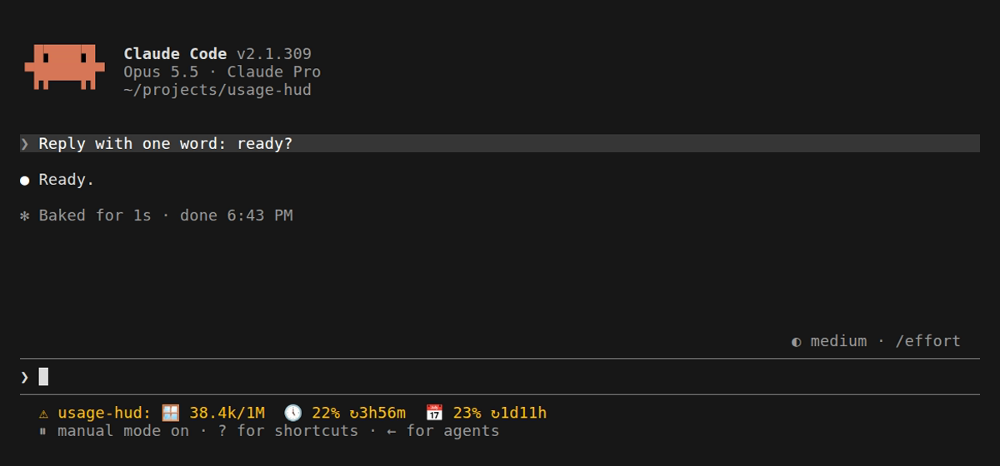

# usage-hud: context window and usage limits in the Claude Code status line

[](https://sonarcloud.io/summary/new_code?id=marcelomiyake_usage-hud)
[](https://sonarcloud.io/summary/new_code?id=marcelomiyake_usage-hud)

See how much room you have left, without running `/context` or `/usage`. usage-hud is a [Claude Code](https://code.claude.com) plugin (a mod, in Claude Code's terms: a plugin with a hooks module). It pins one line of icons under the prompt:

```
🪟 45.2k/1M  🕔 23% ↻2h13m  📅 41% ↻4d21h
```



Claude Code draws each plugin's status entry with the plugin's name and its notice marker in front (`⚠ usage-hud:`). That framing is the engine's, and a mod cannot change it.

| Icon | What it shows                                                                                             |
| ---- | --------------------------------------------------------------------------------------------------------- |
| 🪟   | The context window: tokens in use over the window's size (`200k`, `1M`). `—` before the first response.   |
| 🕔   | The current 5-hour session window, as a percentage used. It drops to 0% once the window resets.           |
| 📅   | This week's window, as a percentage used.                                                                 |
| ↻    | After a window's percentage: the time left until it resets (`2h13m`, `45m`, `4d21h`).                     |
| 🎁   | A usage-limit reset you can use, with the date it expires. Shown only when the reset is known; see below. |

## Features

- **Icons, no labels.** The line stays short enough to sit beside Claude Code's own notices.
- **Always current.** It updates after every turn, from the figures Claude Code pushes, and re-checks once a minute, so the countdowns tick and a window that has reset reads 0% without waiting for the next prompt.
- **Honest about what it doesn't know.** A figure Claude Code does not report is left out, never shown as zero. With an API key instead of a subscription there are no 5-hour or weekly windows, so only 🪟 shows.
- **Never shows full too early.** 99.6% reads 99%, and 100% means the limit is reached.
- **Costs nothing.** It reads figures Claude Code already holds. It makes no request and spends no tokens.

## Install in Claude Code

Requires Claude Code 2.1.309 or later; `claude --version` shows yours. The mods API is in early access and can change between releases.

At the prompt of a Claude Code terminal session:

```
/plugin install usage-hud --marketplace marcelomiyake/usage-hud
```

Answer `y` to add the marketplace, then choose a scope. From a shell instead:

```
claude plugin install usage-hud --marketplace marcelomiyake/usage-hud
```

To try it from a checkout without installing: `claude --plugin-dir .`.

## Known limitations

- **🎁 needs Claude Code to report resets to mods, and it does not yet.** Claude Code fetches reset offers from claude.ai with your account's credentials and shows them only in its own `/limit-reset` notice. The mod API gives a mod no reset offers. usage-hud will not read your credentials or call private endpoints to find one, so the gift stays hidden for now. The core already handles offers, so the gift shows as soon as the API reports them.
- The context fill is unknown until the first response of the window: after start-up, `/clear` or a compaction, 🪟 reads `—/1M` until Claude answers.
- The 5-hour and weekly figures are from the last response. Between turns, the line only knows a window has reset when its reset time passes.

## What it reads, sends, and stores

- **Reads** the context window's size and fill, and the 5-hour and weekly windows' percentages and reset times, from `$.session.usage()` and the `session.measure` event. It reads nothing else.
- **Sends** nothing. The mod makes no network requests.
- **Stores** nothing. It writes no files and keeps nothing between sessions.
- **Writes** only its own status line, with `$.ui.status`.
- **Hooks** `session.start` to draw the line and start the one-minute re-check, and `session.measure` to follow the figures after each turn.
- **Code.** [`hooks/register.js`](hooks/register.js) is generated by esbuild from the TypeScript in [`src/`](src) and is not minified.

[SECURITY.md](SECURITY.md) has the security policy, and [PRIVACY.md](PRIVACY.md) has the privacy policy.

## Architecture

The usage model does not know about Claude Code. It follows Domain-Driven Design and Clean Architecture:

```
src/
├── core/                         the product, free of any tool's API
│   ├── domain/                   TokenCount, ContextWindow, UsageLimit, ResetOffer,
│   │                             UsageSnapshot, StatusLine
│   └── application/              the ShowUsage use case and UsageReading,
│       └── ports/                UsageSource, Clock, StatusDisplay
└── infrastructure/
    └── claude-code/              the mod: register.ts (composition root), session-usage.ts
.claude-plugin/                   plugin.json, and marketplace.json pointing at the root
hooks/register.js                 the mod's hooks module, bundled from src/ by npm run build
```

[AGENTS.md](AGENTS.md) has the commands, the rules that keep the layers apart, the SonarQube quality gate, and the commit conventions.

## Development and testing

```bash
npm ci
npm run test:coverage          # vitest, with coverage
npm run types:sync             # copy the Claude Code API types (see AGENTS.md)
npm run typecheck
npm run build                  # bundle src/ into hooks/register.js
npm run validate:plugin        # claude plugin validate
npm run test:plugin            # claude plugin test, inside Claude Code's engine
claude --plugin-dir .          # try it
vhs docs/statusline.tape       # re-capture docs/statusline.png (calls the model once)
```

## Support

- **Questions and bugs:** [open an issue](https://github.com/marcelomiyake/usage-hud/issues). Include your Claude Code version and the plugin version.
- **Security problems:** report them privately, as [SECURITY.md](SECURITY.md) describes. Do not open a public issue.

## License

[MIT](LICENSE)
